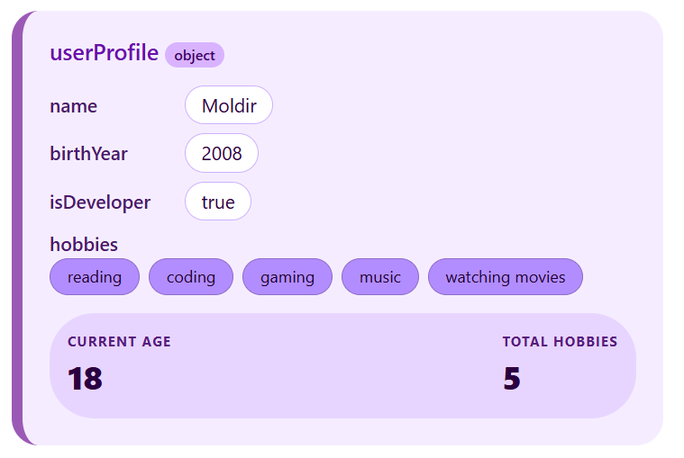
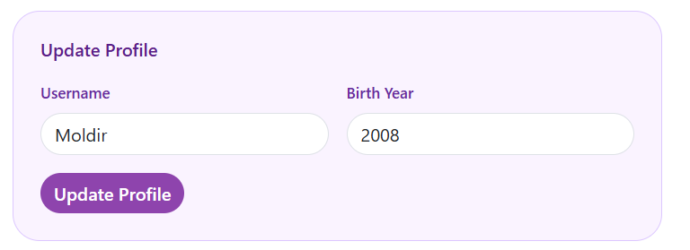
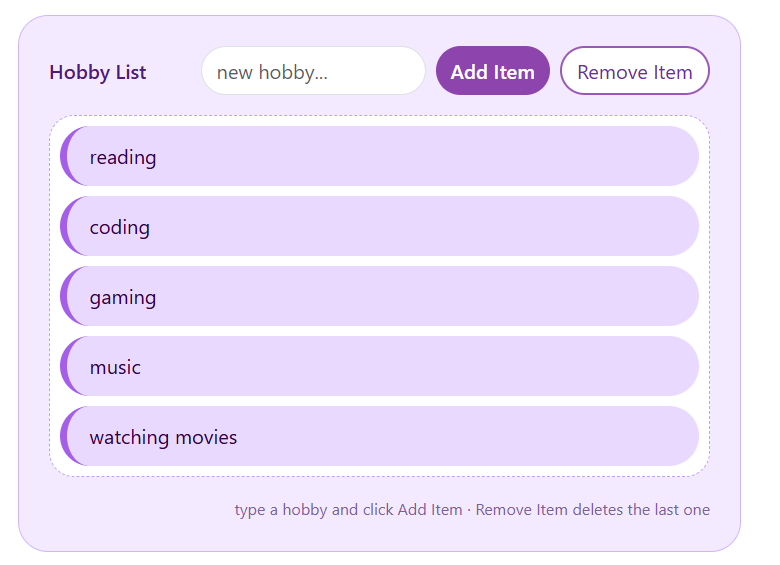

# Assignment 5 — Objects, Events and DOM Manipulation

**Name:** Moldir Jarmukhambetova  
**Group:** SE-2540

A single-page project covering all five tasks — a personal info object, arithmetic calculations, a profile form with an event listener, and a dynamic hobby list with add/remove buttons.

---

## Part 1: Profile Object, Data Types & Arithmetic

### Task 1: The Personal Info Object

Created a const object named userProfile with four data types: name (string), birthYear (number), isDeveloper (boolean), and hobbies (array). All values are displayed on the page inside the profile card.

### Task 2: Arithmetic Calculations

Used arithmetic operators to calculate the user's age dynamically as 2026 - birthYear. For the second metric I used hobbies.length to show the total number of hobbies. Both numbers update every time the profile changes.

---

## Part 2: Form Input & Event Responses

### Task 3: HTML Form Setup

Built a form with two inputs — Username and Birth Year — plus a "Update Profile" submit button. Styled it with Bootstrap's grid and form classes.

### Task 4: Event Listener

Added a click event listener to the button. When clicked, it reads both input values with .value, updates userProfile.name and userProfile.birthYear, then re-renders the page. The form inputs are also prefilled from userProfile on load.

---

## Part 3: DOM List Manipulation

### Task 5: Creating & Removing Elements

Created a <ul> hobby list. The "Add Item" button reads the text from an input field, pushes it to the hobbies array, and re-renders the list using createElement and appendChild. The "Remove Item" button uses pop() to delete the last hobby. Both buttons update the hobby badges and the total hobbies count at the top of the page.

---

## Summary

I built one HTML page with all the tasks in sections and styled it with a purple theme using Bootstrap's grid and utility classes plus a small custom stylesheet for the colors. Task 1 is the object, Task 2 is the age and hobby count arithmetic, Tasks 3 and 4 are the form and the button that updates the object, and Task 5 is the add/remove list. I also added localStorage so the profile survives a page refresh. Most of the work was in the JavaScript — making sure the badges, the metric box and the list all re-render after every change took longer than the HTML did.